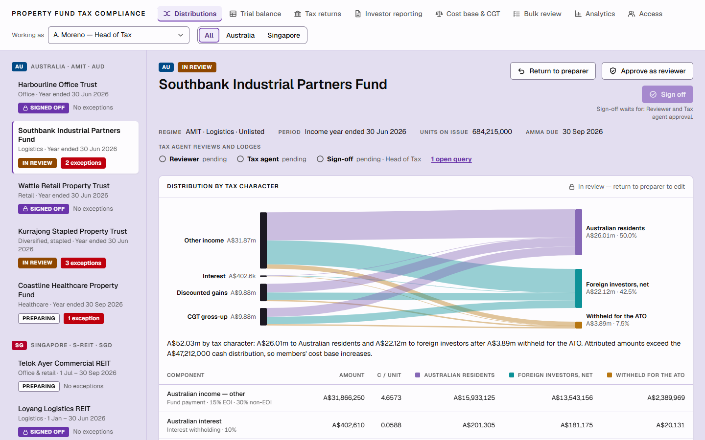
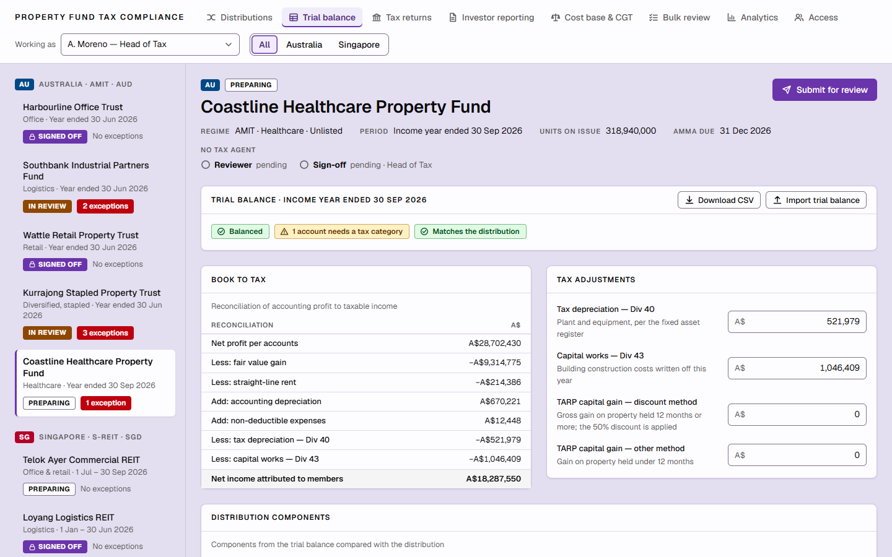
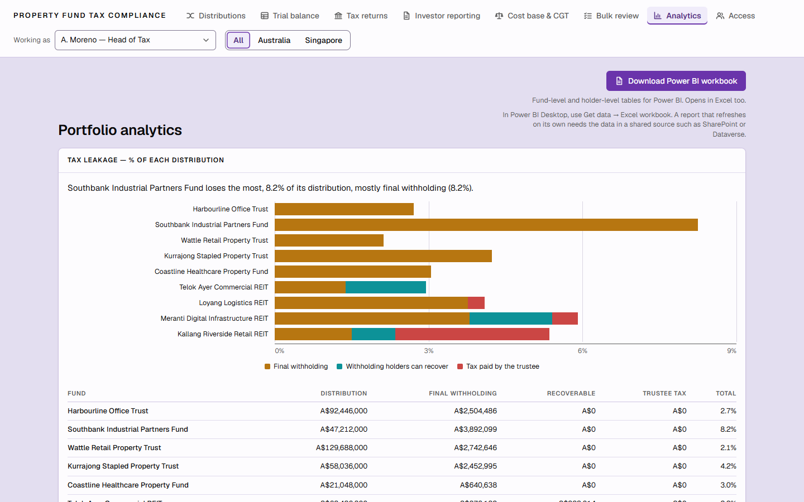

# Property Fund Tax Compliance

A browser-only demo of how a property fund's tax team could prepare, review and sign off distributions for **Australian AMITs/MITs (AUD)** and **Singapore S-REITs (SGD)**, from trial balance to investor notices.

**Live demo:** <https://peterxing.github.io/property-fund-tax-compliance/>

> Demonstration only. The funds, holders, trial balances and people are fictional, the rules come from an engine that no tax adviser has reviewed, and nothing is submitted to the ATO or IRAS. Read [docs/LIMITATIONS.md](docs/LIMITATIONS.md) before relying on any figure.

## What it does

Eight workspaces behind one header, with a **Working as** switch that changes what each role can do (preparer, reviewer, tax agent, Head of Tax, view only) and an **All / Australia / Singapore** filter:

| Workspace | What you can do |
|---|---|
| **Distributions** | See a fund's distribution by tax character (Sankey, components, per-holder withholding), edit inputs while *Preparing*, then work through **Withholding, Statements, Checks, Queries, Audit trail** and **Rules** |
| **Trial balance** | Book-to-tax reconciliation, tax adjustments, account-to-category mapping, CSV import and export, and "update distribution from trial balance" |
| **Tax returns** | Readiness checklist, record a lodgment reference, working-papers document and PDF (AMIT return and schedule, or Form UT) |
| **Investor reporting** | AU fund payment notices, AIIR and withholding report; SG distribution tax notice and s45G withholding filing |
| **Cost base & CGT** | Unrealised CGT and deferred tax by investor type (AU), unit cost base after AMIT cost base net amounts or returns of capital |
| **Bulk review** | Submit, approve or sign off many funds at once, with reasons for every fund skipped |
| **Analytics** | Tax leakage, distribution mix, deadlines, a distribution scenario, and a Power BI workbook export |
| **Access** | Users and fund access, governance mode per fund, the permissions matrix, and **Reset demo data** |






The workflow is **Preparing, In review, Signed off**. Governance per fund decides whether a tax agent approves, signs off or lodges. Signed-off funds are locked until reopened, and every step lands in the audit trail.

Nine fictional funds ship with the demo: five Australian AMITs (Harbourline, Southbank, Wattle, Kurrajong, Coastline) and four Singapore S-REITs (Telok Ayer, Loyang, Meranti, Kallang), chosen so that each shows a different situation (an overdue AMMA, an under-remitted withholding variance, an unmapped account, a payout below the 90% condition, and so on).

## Run it

```powershell
npm ci
npm run dev        # rebuilds on change into dist/
npm run preview    # serves dist/ at http://127.0.0.1:4173
```

```powershell
npm test           # engine + domain + UI tests
npm run typecheck
npm run build      # static site in dist/
```

Node 22 or later. There is no server, database or configuration. Your edits live in the browser (`localStorage`); **Access, Reset demo data** restores the original data.

## How it is built

* `src/engine`: the calculation core. Pure TypeScript in integer cents, cited to legislation, with its own tests: trust components, MIT withholding and due dates (AU); REIT tax transparency, withholding and Form UT (SG).
* `src/domain`: the product logic. Types, seed data, workflow and permission rules, per-market modules (`au/`, `sg/`) that turn engine output into view models, and a store. No DOM or React.
* `src/app`: React 19 UI (esbuild, no UI kit): shell and design system, one folder per workspace, and CSV, XLSX and PDF exports that load on demand.
* `test`: the engine suite, domain tests including golden tests against the reference figures, helper tests, and headless-DOM UI tests.

See [docs/ARCHITECTURE.md](docs/ARCHITECTURE.md), [docs/DEPLOYMENT.md](docs/DEPLOYMENT.md), [docs/REFERENCE-PARITY.md](docs/REFERENCE-PARITY.md) and [docs/rules](docs/rules).

## Relationship to the reference prototype

This repository re-implements, on top of an existing and separately tested tax engine, the product shape of a managed-app prototype of the same idea, so that the two can be compared side by side. It copies no source from that prototype. Wherever the prototype and the engine or the law disagree, the engine and the cited law win and the difference is recorded in [docs/REFERENCE-PARITY.md](docs/REFERENCE-PARITY.md).
